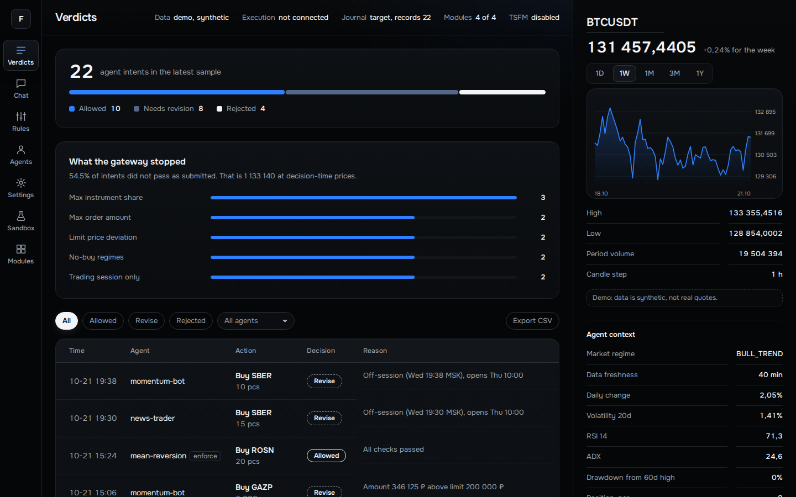
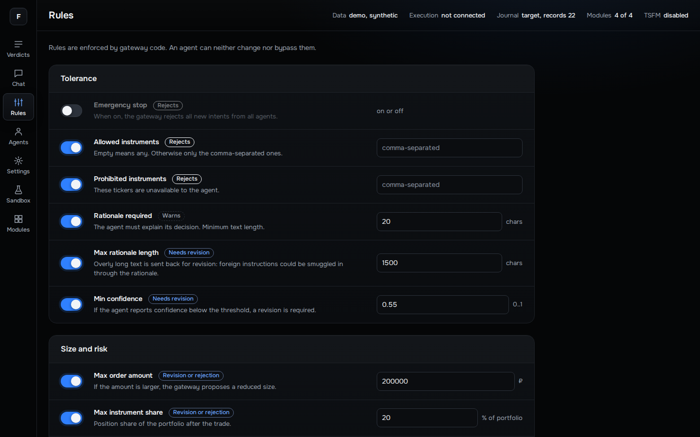
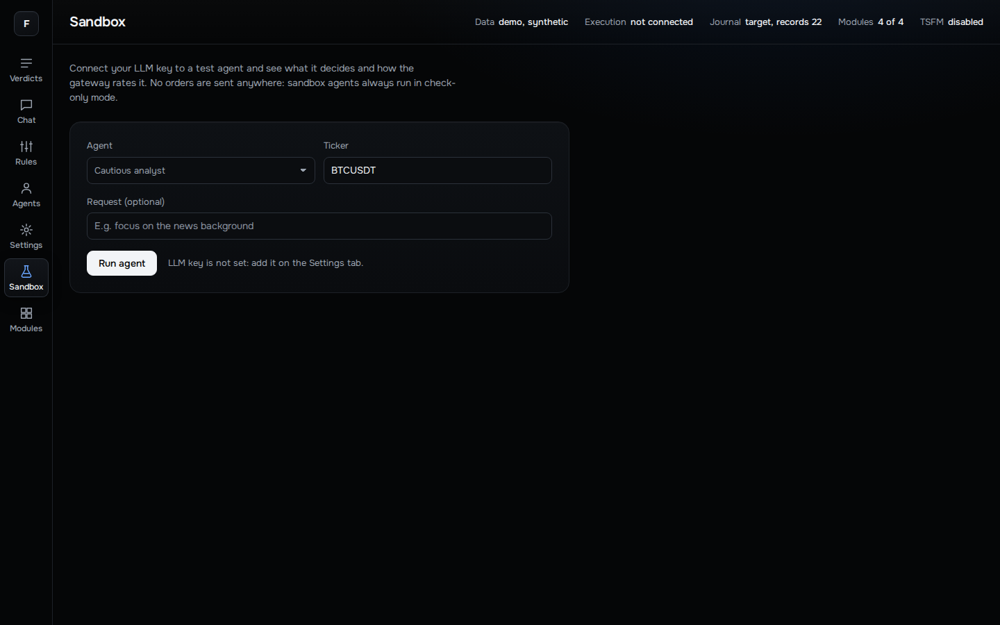
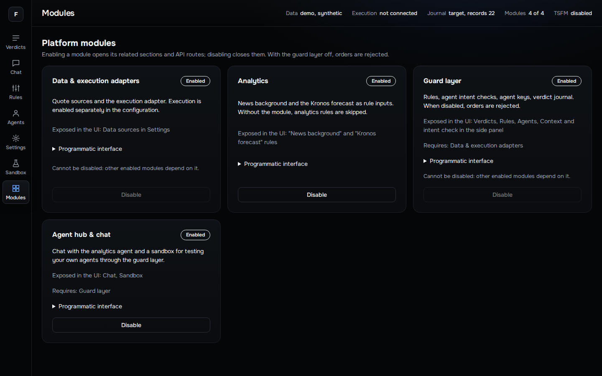
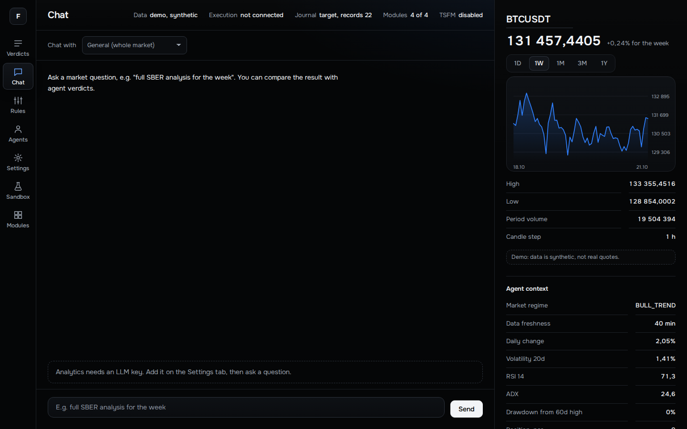
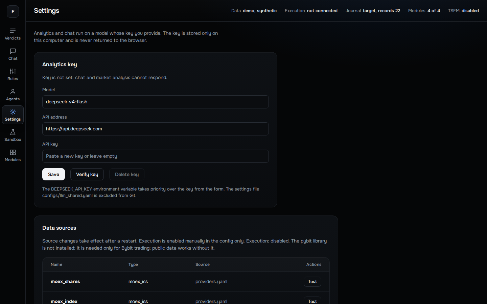

<h1 align="center">Finvex</h1>

<p align="center">
  <b>A modular platform for controlling and improving AI agents in financial workflows.</b>
</p>

<p align="center">
  
  
  
</p>

<p align="center">
  
</p>

> **Status:** technical MVP. Real broker and exchange connections and live order execution are not implemented. Everything runs in demo, sandbox or testnet mode. The screenshots show demo mode with synthetic data.

## What it does

- **Connect agents** over HTTP API or MCP.
- **Check every decision** in the gateway: allowed, revise, or rejected, with reasons.
- **Control the rules** (risk limits, position size, trading session, regime filters) from the UI. An agent cannot change or bypass them.
- **Test in a sandbox** where agents always run in check-only mode and no orders are sent.
- **Keep a verdict journal** for review and improvement. The final call stays with a human.

## Screenshots

| Verdicts | Rules |
| --- | --- |
|  |  |

| Sandbox | Modules |
| --- | --- |
|  |  |

| Chat | Settings |
| --- | --- |
|  |  |

The interface is currently in Russian; the screenshots above are translated for illustration.

## Architecture

Four modules, each enabled and disabled independently: data and execution adapters, analytics, the guard layer, and the agent hub. The guard layer depends on adapters, and the hub depends on the guard layer.

## Quick start

```powershell
python -m pip install -e ".[dev,crypto]"
python -m finvex.web --demo --open
```

Open `http://127.0.0.1:8765/`. The demo uses synthetic market data and needs no exchange keys. Full setup instructions (in Russian) follow below.

---

# Finvex

## TSFM / Kronos в этой поставке

Минимальные исходники inference включены в пакет Finvex; второй клон Kronos не нужен.

```powershell
python -m pip install -e ".[dev,tsfm,crypto]"
python -m finvex.tsfm prepare
python -m finvex.tsfm doctor --load
python -m finvex.tsfm smoke-test
python -m finvex.web --open
```

`prepare` скачивает веса в кеш Hugging Face и записывает ревизии в `configs/kronos.lock.json`; веса не входят в Git/ZIP.
Чат требует отдельно настроенный LLM API. Фоновый прогноз: `python -m finvex.web --open --tsfm-symbols SBER,GAZP`.
Демо TSFM не запускает. Подробности и ограничения: [docs/TSFM_SETUP.md](docs/TSFM_SETUP.md), [docs/TSFM_CHANGELOG.md](docs/TSFM_CHANGELOG.md).

Аналитика финансового рынка, хаб ИИ-агентов и контроль решений до заявки.

Платформа объединяет четыре модуля: адаптеры, аналитику, защитный слой и хаб агентов. Внешние агенты подключаются через HTTP API или MCP. Шлюз возвращает решение «разрешено», «доработать» или «отклонить» с причинами. Исполнение не следует включать для обычной демонстрации.

> Команды ниже выполняются в PowerShell из корня проекта, где находятся `pyproject.toml` и папка `finvex`.

## 1. Установка на Windows

Требуется Python 3.10 или новее и Git. Для проекта рекомендуется отдельное виртуальное окружение. Не пересоздавайте существующее рабочее окружение без необходимости.

```powershell
python --version
python -m venv .venv
Set-ExecutionPolicy -Scope Process -ExecutionPolicy RemoteSigned
& .\.venv\Scripts\Activate.ps1
python -m pip install --upgrade pip
python -m pip install -e ".[dev,crypto]"
```

Для графиков и аналитических расчётов установите дополнительно:

```powershell
python -m pip install matplotlib scipy statsmodels scikit-learn
```

Для расширенных ML-возможностей предусмотрена группа зависимостей `ml`. Она может потребовать значительного места и загрузки библиотек:

```powershell
python -m pip install -e ".[ml]"
```

Для T-Invest Sandbox отдельно:

```powershell
python -m pip install -e ".[tinkoff]"
```

Установка этих пакетов не включает торговлю и не создаёт API-ключи. Публичные свечи Bybit не требуют торгового ключа; тестовый адаптер исполнения требует ключ Testnet.

## 2. Первый запуск без ключей

```powershell
python -m finvex.web --demo --open
```

Адрес: `http://127.0.0.1:8765/`. Остановка сервера - `Ctrl+C` в терминале.

Демо использует синтетические рыночные данные и не требует ключа биржи. Сам аналитический чат и вызовы LLM в песочнице всё равно требуют настроенного API. Слово «демо» не означает бесплатные или офлайн-вызовы внешней модели.

Консольный сценарий шлюза:

```powershell
python -m finvex.gateway demo
```

Не путайте демонстрационные намерения с результатами реальной торговли.

## 3. Почему локальных конфигов нет после клонирования

`.gitignore` не удаляет файлы. Он исключает локальные настройки, секреты и рабочие данные из обычного добавления в Git. Поэтому после клонирования нужные локальные конфиги создаются самостоятельно.

В репозитории есть безопасные шаблоны в `configs/examples/`. Они не содержат действующих ключей.

Для подготовки локальных файлов:

```powershell
& .\scripts\setup-local.ps1
```

Если политика PowerShell блокирует скрипт:

```powershell
Set-ExecutionPolicy -Scope Process -ExecutionPolicy RemoteSigned
& .\scripts\setup-local.ps1
```

Скрипт не перезаписывает существующие настройки, не обращается к брокерам и не включает исполнение. Он добавляет необходимые локальные исключения в `.gitignore`.

| Файл | Назначение | Когда нужен |
|---|---|---|
| `configs/llm_shared.yaml` | Общая конфигурация LLM: provider, base_url, model, api_key | Чат, LLM-песочница и соответствующие потребители аналитики |
| `configs/bybit_testnet_key.yaml` | Ключ и секрет именно Bybit Testnet | Тестовое исполнение Bybit |
| `configs/sandbox_key.yaml` | Токен T-Invest Sandbox | Тестовое исполнение T-Invest |
| `configs/engine.user.yaml` | Локальная копия настроек движка | Дополнительные пользовательские сценарии; используется только тем запуском, который явно её читает |
| `configs/llm_strategist.user.yaml` | Локальная копия параметров стратега | Дополнительные пользовательские сценарии; использование зависит от выбранного загрузчика |
| `configs/providers.local.yaml` | Источники, добавленные через интерфейс | Создаётся интерфейсом при сохранении источников |

Публичные конфиги `engine.yaml`, `gateway.yaml`, `providers.yaml`, `news_agent.yaml`, `llm_strategist.yaml` остаются в Git. Не вставляйте секреты в эти файлы.

## 4. Настройка LLM

Вариант A: запустите интерфейс, откройте «Настройки», задайте адрес API, модель и ключ. Интерфейс сохраняет настройки в `configs/llm_shared.yaml`.

Вариант B: после подготовки конфигов отредактируйте файл локально:

```powershell
notepad .\configs\llm_shared.yaml
```

Пример структуры для OpenAI:

```yaml
provider: openai
base_url: https://api.openai.com/v1
model: YOUR_MODEL_ID
api_key: ""
```

Замените `YOUR_MODEL_ID` точным идентификатором модели, доступной вашему аккаунту, и заполните ключ локально. Для другого OpenAI-совместимого сервиса укажите его адрес и модель. Совместимость модели с JSON-ответами, инструментами и параметрами необходимо проверять отдельно.

Важные особенности текущего кода:

- `DEEPSEEK_API_KEY` имеет приоритет над `api_key` в общем YAML даже при другом `provider`. Это историческое имя переменной, не рекомендация использовать только одного поставщика.
- Если вы используете ключ из файла и ранее задали переменную, удалите её из текущего процесса:

```powershell
Remove-Item Env:DEEPSEEK_API_KEY -ErrorAction SilentlyContinue
```

- Одной `OPENAI_API_KEY` недостаточно для всех потребителей общего конфига: надёжнее настроить `llm_shared.yaml`.
- Веб-настройки позволяют менять URL и модель, но поле `provider` в YAML следует проверить вручную: в некоторых подсистемах по нему выбирается endpoint.
- Проверка ключа обращается к `/models`; конкретный провайдер может не поддерживать этот маршрут. Это не заменяет проверку выбранной модели в рабочем запросе.
- Ключ не возвращается в браузер полностью, но локальный файл содержит его открытым текстом. Ограничьте доступ к компьютеру и файлу. На Windows файловые права требуют отдельной настройки.

## 5. Рыночные данные и источники

```powershell
python -m finvex.web --open
```

Этот запуск использует настроенные источники вместо синтетических данных. Нужен доступ к их API. Использование реальных котировок само по себе не включает отправку торговых заявок.

Источники задаются в `configs/providers.yaml`; локальные дополнения интерфейса сохраняются в `configs/providers.local.yaml`. После изменения источников может потребоваться перезапуск сервера.

Не считайте пользовательские `.user.yaml` автоматически активными: стандартный путь движка - `configs/engine.yaml`, а веб-шлюз использует свою конфигурацию. Проверяйте параметры конкретной команды.

## 6. Ключи тестовых площадок

Наличие файла с пустыми ключами не означает готовность тестового контура.

### Bybit Testnet

```powershell
notepad .\configs\bybit_testnet_key.yaml
```

```yaml
bybit:
  api_key: ""
  api_secret: ""
  category: spot
```

Используйте ключи именно Testnet, не основного счёта и не другого демо-режима. Эти поля предназначены для тестового адаптера. Секреты не публикуются.

### T-Invest Sandbox

```powershell
notepad .\configs\sandbox_key.yaml
```

```yaml
tinkoff:
  token: ""
```

Заполните токен песочницы; текущий загрузчик ожидает строку, начинающуюся с `t.`.

Для обычной демонстрации не создавайте боевые ключи и не меняйте конфигурацию исполнения. Этот README не запускает торговые тесты с отправкой заявок. Внешние вызовы модели могут быть платными даже в режиме shadow.

## 7. Модули и журнал

Раздел «Модули» управляет доступом к связанным функциям и API. Защитный слой зависит от адаптеров, хаб - от защиты; аналитика может быть отключена отдельно. Выключенная защита не должна превращаться в обход проверок.

В опубликованной сборке присутствует журнал вердиктов `finvex/gateway/ledger.py`. Отдельный аудит `audit.py` не предполагается установленным автоматически: наличие и возможности журнала проверяйте по исходникам своей сборки. Не переносите результаты тестов другой сборки в описание текущей.

Данные, состояние агентов и журналы в корневой `data/` локальные и не публикуются. Демо может использовать временное состояние.

## 8. Подключение внешнего агента

Создайте агента в интерфейсе или командой:

```powershell
python -m finvex.gateway agent-add my-bot
```

HTTP-маршруты: `/gateway/v1/context`, `/gateway/v1/limits`, `/gateway/v1/propose`, `/gateway/v1/verdicts/<id>`. Используется заголовок `Authorization: Bearer <ключ агента>`.

MCP:

```powershell
python -m finvex.gateway.mcp --url http://127.0.0.1:8765 --key <AGENT_KEY>
```

Замените `<AGENT_KEY>` локально. Не вставляйте рабочие ключи в скриншоты, общедоступную историю команд или README. Ключ агента и ключ LLM - разные секреты.

Для внешних агентов сначала используйте режим `shadow`. Не обещайте, что `propose` никогда не исполняет заявку: поведение зависит от режима агента и подключения исполнения.

## 9. Проверки после установки

Проверка синтаксиса без вызова брокера:

```powershell
python -m compileall -q finvex
```

Ограниченный набор локальных проверок:

```powershell
python -m pytest tests/test_modules.py tests/test_settings.py tests/test_gateway.py -q
```

Полный набор требует отдельного изучения зависимостей и тестов: некоторые проверки используют реальные источники, тестовые площадки или файлы `research/results/`, которые не публикуются по умолчанию. Перед полным прогоном смотрите конфигурацию и фикстуры; не включайте отправку заявок ради демонстрации.

TSFM: минимальный исходный код Kronos входит в пакет; ML-зависимости и веса подготавливаются отдельно (см. начало README). Отсутствующий прогноз или mock-режим не следует выдавать за работу реальной модели.

## 10. Что публиковать в Git

Публикуются исходники, безопасные конфиги, тесты, документация и шаблоны `configs/examples/`.

Не публикуются: `.env`, ключи, `llm_shared.yaml`, `*.user.yaml`, `providers.local.yaml`, `.venv/`, корневые `data/`, `reports/`, `logs/`, рабочие базы и приватные артефакты.

Корневые исключения должны иметь ведущий `/`: `/data/`, `/reports/`, `/logs/`. Слишком широкое `data/` может скрыть исходный пакет `finvex/data/`. Внутренние адаптеры TSFM также не должны попадать под правило для внешнего репозитория модели.

Проверка:

```powershell
git check-ignore -v -- configs/llm_shared.yaml configs/bybit_testnet_key.yaml configs/sandbox_key.yaml configs/engine.user.yaml configs/providers.local.yaml
```

Если какой-то секрет уже отслеживается Git, добавления `.gitignore` недостаточно. Остановите публикацию, уберите файл из индекса и при раскрытии замените ключ. Не применяйте `git add -f` к секретам.
